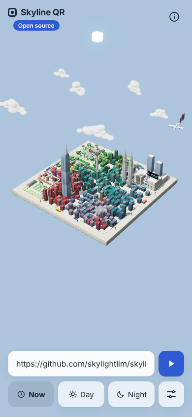
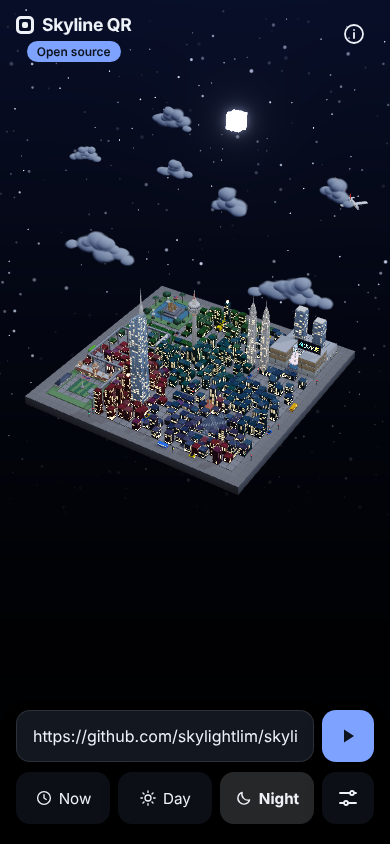
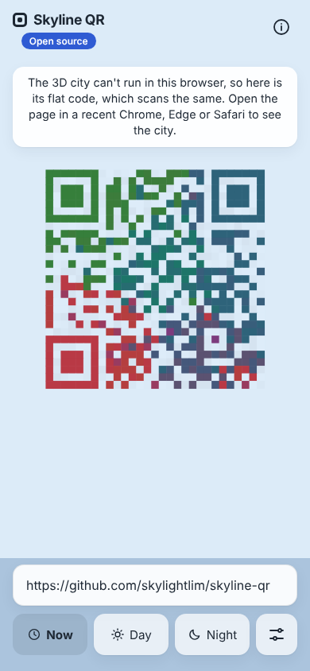
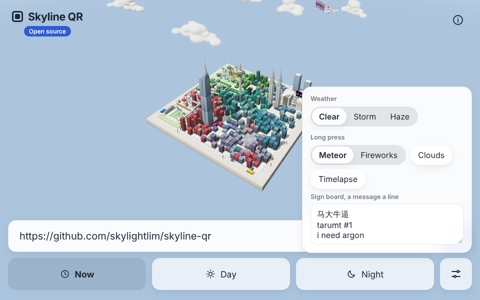

# Skyline QR

**Turn any link into a tiny 3D city that folds into its own QR code.**

Paste a link and a little city grows out of it, with towers, streets, a monorail, traffic and a
plane drifting overhead. Tap the city and it folds flat into a real QR code that any phone camera
can scan. Tap again and it rises back up.

The trick is that the city *is* the code. Every building stands on one square of the QR code, so
the skyline and the code are the same grid seen two ways.

### [Try it in your browser](https://skylightlim.github.io/skyline-qr/)

Nothing to install or sign up for. There is also an [Android app](#the-android-app).

<p align="center">
  
  &nbsp;
  
  &nbsp;
  
</p>
<p align="center"><em>The same link by day, by night, and folded into its QR code.</em></p>

## What you can do

| Do this | And you'll see |
| --- | --- |
| **Paste a link** | A new city builds as you type. |
| **Tap the city** | It folds into its QR code. Point a phone camera at it to open the link. Tap again to rebuild the city. |
| **Drag** | The city turns so you can look around it. |
| **Pinch or scroll** | Zoom in and out. |
| **Long-press** | A meteor crashes into the city, leaves a glowing crater, and the city rebuilds itself. Or switch it to fireworks. |
| **Now / Day / Night** | *Now* follows your own clock: sunrise, daylight, sunset and a starry night with lit windows. *Day* and *Night* pin the hour. |
| **Tour** (the ▶ button) | The camera flies past every landmark, then lands and folds the city into its code. |

The settings button (the sliders, bottom right) holds the extras:

- **Weather:** clear skies, a storm with rain and lightning, or a haze that rolls in.
- **City colours:** the colourful city, or a quiet grey blue one. Both scan the same.
- **Long press:** choose a meteor or fireworks.
- **Clouds:** turn the clouds on or off.
- **Timelapse:** watch the city go from midday to night in fifteen seconds, with shadows
  sweeping round and the windows coming on.
- **Sign board:** write your own messages for the big screen on the shopping mall, one per line.

<p align="center">
  
</p>

## Examples

Every link gets its own city, and **the same link always builds the same city**, on any phone or
computer, every time. Nothing is stored on a server: the city comes from the link itself.

| Try typing | What happens |
| --- | --- |
| `https://github.com/skylightlim/skyline-qr` | The city the website opens with. Fold it and scan it, and you land back on this page. |
| `https://example.com` | A completely different skyline, with its own colours and layout. |
| `https://example.com/about` and then `https://example.com/contact` | The same city both times, because the pages share a website, yet each folded code opens its own page. |
| A link with a password or token in it | The city still builds, with a gentle warning to think twice before sharing its code. |
| Something that isn't a link, or a very long link | The last good city stays on screen and a short note says what's wrong (a link too long to scan well asks for a shorter one). |

The city is drawn after Kuala Lumpur. Look for the tall spire of Merdeka 118, the Menara KL
telecom tower, the Petronas Twin Towers with their skybridge, the monorail running round the
edge, a garden, a square and a mall with a fountain.

## Which browsers show the city?

The 3D city needs a browser with WebGPU, a newer graphics feature:

- **Chrome, Edge and recent Safari** show the full city.
- **Firefox and Zen** (and other browsers without it) show the flat QR code instead, with a short
  note. The code still scans, so the link always works.

## The Android app

The app has everything the website has, plus a few things only a phone can do.

- **Tap to share.** Hold your phone against a friend's and their phone opens your link. They don't
  need the app, and it works with iPhones too. Android phones can also be handed a Wi-Fi network
  to join or a contact to save.
- **Cards.** Keep a set of things to share: links, notes, contacts, Wi-Fi networks and payment
  codes such as DuitNow. Links and payment codes each get their own city.
- **Scan.** Point the camera at a QR code to save it as a new card.
- **Quick tour.** Long-press the app's icon on your home screen and pick *Tour*.

Download it from the [Releases](https://github.com/skylightlim/skyline-qr/releases) page. It needs
Android 8.0 or newer and a phone with Vulkan graphics (most phones from the last several years).

---

## For developers

<details>
<summary>The library, the modules and how to build</summary>

Skyline QR is written in Kotlin. The phone draws the city with WebGPU and WGSL shaders through
[androidx.webgpu](https://developer.android.com/jetpack/androidx/releases/webgpu) (alpha), and the
website runs the same code as Kotlin/Wasm on the browser's WebGPU. Where WebGPU can't start, a
flat 2D code takes its place. See [docs/DESIGN.md](docs/DESIGN.md) for the full design and
[docs/NFC.md](docs/NFC.md) for tap to share.

**Use the library** through [JitPack](https://jitpack.io/#skylightlim/skyline-qr):

```kotlin
// settings.gradle.kts
dependencyResolutionManagement { repositories { maven("https://jitpack.io") } }
// build.gradle.kts
implementation("com.github.skylightlim.skyline-qr:skylineqr-compose:v1.0.0")
```

```kotlin
SkylineQrCode(
  url = "https://example.com",
  modifier = Modifier.fillMaxSize(),
  city = CityPreset.KUALA_LUMPUR,  // the default; or GENERIC
  time = TimeOfDay.AUTO,           // or DAWN, DAY, DUSK, NIGHT
  weather = Weather.CLEAR,         // or RAIN, HAZE, STORM
  longPress = LongPress.METEOR,    // or FIREWORKS
)
```

`state.resetCamera()`, `state.startTour()` and `state.startTimelapse()` drive the camera and the
clock, and `onEvent` reports lightning and meteors if you want to add sound. By default every page
on one site shares a city; pass `identityScope = IdentityScope.URL` to give each page its own. A
saved city should record `GeneratorVersion.CURRENT` and pass it back as `generatorVersion`, so it
never changes when the generator improves.

| Module | What it is |
| --- | --- |
| `skylineqr-core` | Kotlin Multiplatform (JVM and Wasm): link parsing, identity, the QR matrix and the city planner. |
| `skylineqr-compose` | The renderer and the `SkylineQrCode` composable. |
| `skylineqr-nfc` | Tap to share, tag reading and writing, and a QR scanner. |
| `app` | The demo app. |
| `skylineqr-web` | The website, published to GitHub Pages on every push to main. |

**Build and test** (JDK 17+ and the Android SDK; compileSdk 37 for the app, 36 for the libraries):

```bash
./gradlew test allTests assembleDebug                      # unit tests and the demo app
./gradlew :skylineqr-compose:connectedDebugAndroidTest     # renders and scans frames on a connected phone
./gradlew :skylineqr-web:wasmJsBrowserDevelopmentRun       # the website on a local dev server
```

</details>

## Credits

Inspired by [Every QR Code](https://github.com/AlbertAZ1992/every-qrcode) (MIT; its link parsing and
versioning are adapted here), Enzo Manuel Mangano's
[Cherry Blossom QR Code](https://reactiive.io/demos/cherry-blossom-qrcode) (idea only) and
[ICQR Magic Tree](https://tree.icqr.com). Details in [NOTICE](NOTICE).

## License

[MIT](LICENSE)
